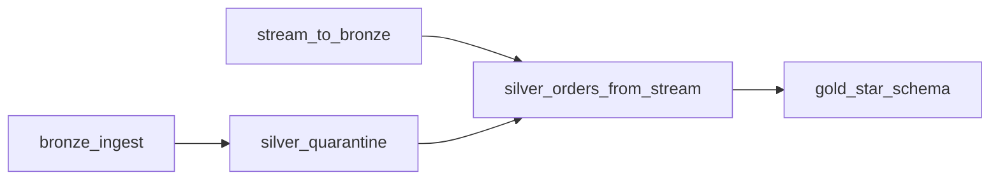
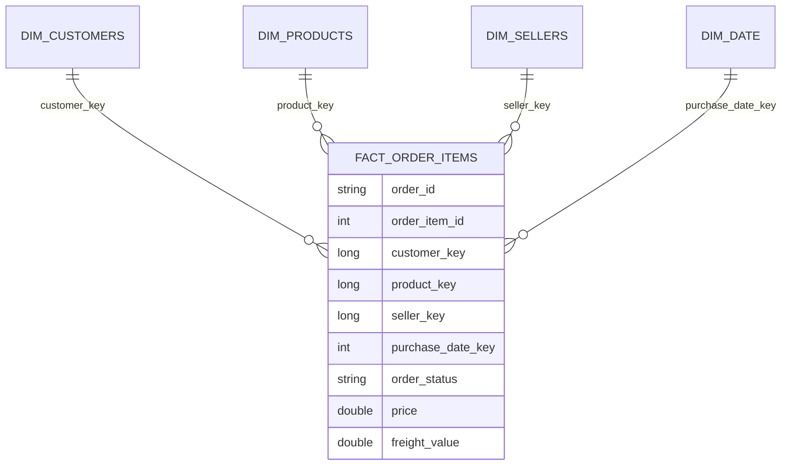

# Lakehouse Olist en streaming


Projet de portfolio en Data Engineering : architecture lakehouse (médaillon) construite autour du dataset public Olist (e-commerce brésilien), avec ingestion batch et streaming, contrôles qualité (quarantaine et portes bloquantes), modèle en étoile Kimball, orchestration Airflow et intégration continue GitHub Actions.

**État au 06/11/2026** : le pipeline complet est orchestré par Airflow et s'exécute de bout en bout : ingestion batch des CSV et ingestion en streaming depuis Kafka (en parallèle), Silver avec quarantaine, upsert du flux dans Silver, puis Gold en étoile. Une CI (lint + tests unitaires) vérifie chaque push, et les secrets ne sont plus dans le code. Le portage Databricks reste à faire (voir [Avancement](#avancement)).

## Architecture

Cible :

```
Producer Python (rejoue les commandes Olist)
  -> Kafka
  -> Spark Structured Streaming
  -> Delta Lake sur MinIO (S3)
       Bronze (brut)
       -> Silver (nettoyé + règles qualité) + Quarantaine
       -> Gold (modèle en étoile Kimball)
  -> orchestration Airflow, CI GitHub Actions, le tout en Docker Compose
```

Réalisé à ce jour :

```
Branche batch
  CSV Olist (9 fichiers) -> Spark -> Bronze (9 tables Delta)
                                  -> Silver + Quarantaine (lignes rejetées, avec raison)

Branche streaming
  Producer (confluent-kafka, clé = order_id)
    -> Kafka (topic olist_orders, 3 partitions)
    -> Spark Structured Streaming (checkpoint dans MinIO)
    -> bronze/orders_stream (Delta, exactement une fois)
    -> upsert (MERGE sur order_id) dans silver/orders

Les deux branches convergent vers Gold (4 dimensions + 1 table de faits).
```

### Orchestration (DAG `olist_pipeline`)



- `bronze_ingest` et `stream_to_bronze` démarrent en parallèle (branches indépendantes).
- `silver_orders_from_stream` attend `silver_quarantine` : celui-ci **réécrit** `silver/orders` en entier, le `MERGE` doit donc venir après, sinon il serait écrasé.
- `gold_star_schema` attend les deux, car il lit les six tables Silver.
- Un second DAG, `olist_orders_source_simulator`, simule la source externe : il envoie un lot de commandes dans Kafka (paramètres `skip` et `limit`, déclenchement manuel).

Portage prévu ensuite vers Databricks Free Edition (partie batch uniquement : le streaming Kafka reste en local, car Databricks Free Edition ne peut pas joindre un Kafka local). Options : remplacer MinIO par un bucket S3/GCS et tester la charge sur un jeu plus volumineux (NYC TLC).

## Stack technique

| Composant | Version |
|---|---|
| Apache Spark | 3.5.9 (Scala 2.12, Java 11) |
| Delta Lake | 3.3.3 (`delta-spark_2.12` + `delta-storage`) |
| Hadoop / hadoop-aws | 3.3.4 |
| aws-java-sdk-bundle | 1.12.262 |
| Connecteur Kafka de Spark | `spark-sql-kafka-0-10_2.12:3.5.9` (via `--packages`) |
| Stockage objet | fork `pgsty/silo:RELEASE.2026-09-16T00-00-00Z` (compatible S3/MinIO) |
| Kafka | `apache/kafka:4.4.0` (mode KRaft, un nœud) |
| Client Kafka Python | `confluent-kafka==2.16.0` |
| Airflow | 3.3.2, image personnalisée `olist-airflow:3.3.2` (ajoute le client Docker 28.5.1), `LocalExecutor`, PostgreSQL 16 |
| Great Expectations | série 0.18.x (`SparkDFDataset`) |
| boto3 | création des buckets (version non épinglée) |
| CI | GitHub Actions, `ruff` 0.17.3, `pytest` 8.4.2 |

Les versions sont épinglées volontairement (voir [Décisions](#décisions-et-compromis)).

## Structure du dépôt

```
.
├── .github/workflows/ci.yml    # CI : lint (ruff) + tests (pytest)
├── .env.example                # modèle des variables d'environnement (MinIO)
├── .gitattributes              # fins de ligne LF imposées
├── pyproject.toml              # configuration de ruff et de pytest
├── docker-compose.yml          # services minio + spark + kafka
├── docker/spark/Dockerfile     # image Spark custom (dépendances Python)
├── docker/spark/jars/          # jars Spark (non versionnés, voir Setup)
├── requirements.txt            # dépendances Python installées dans l'image Spark
├── requirements-dev.txt        # outils de développement : pyspark, pytest, ruff
├── data/raw/                   # CSV Olist (non versionnés)
├── airflow/                    # projet Compose séparé : Airflow
│   ├── .env.example                # modèle des variables d'Airflow (secrets, UID, GID)
│   ├── Dockerfile                  # image Airflow + client Docker
│   ├── docker-compose.yaml         # compose officiel 3.3.2, simplifié (LocalExecutor)
│   ├── docker-compose.override.yaml# socket Docker monté dans le scheduler seulement
│   └── dags/
│       ├── hello_pipeline.py               # DAG de démonstration
│       ├── olist_pipeline.py               # pipeline complet
│       └── olist_orders_source_simulator.py# simulateur de source (producer)
├── tests/                      # tests unitaires (sans infrastructure)
│   ├── conftest.py                 # fixture SparkSession locale
│   ├── test_quarantine_rules.py    # règles qualité Silver
│   ├── test_stream_rules.py        # règle « date malformée » du flux
│   ├── test_producer.py            # rejeu du producer
│   ├── test_dag_files.py           # garde-fous sur les DAG
│   └── test_config.py              # lecture des secrets depuis l'environnement
└── src/
    ├── common/
    │   ├── config.py           # lecture des variables d'environnement (échec immédiat si absente)
    │   ├── spark_session.py    # SparkSession partagée (config S3A + Delta)
    │   └── storage.py          # création des buckets MinIO manquants (sans conflit entre jobs parallèles)
    ├── producer/
    │   └── orders_producer.py  # rejoue les commandes vers Kafka (clé = order_id)
    ├── streaming/
    │   ├── kafka_to_console.py          # lecture Kafka -> console (validation du connecteur)
    │   ├── orders_stream_to_bronze.py   # Kafka -> bronze/orders_stream (Delta)
    │   └── silver_orders_from_stream.py # bronze/orders_stream -> silver/orders (MERGE)
    └── batch/
        ├── bronze_ingest.py        # CSV -> Bronze (9 tables Delta)
        ├── silver_quarantine.py    # Bronze -> Silver + Quarantaine
        ├── gold_star_schema.py     # Silver -> Gold (étoile Kimball)
        ├── validate_orders.py      # contrôles Great Expectations sur orders
        └── debug_reviews.py        # diagnostic de lecture CSV (order_reviews)
```

## Prérequis

- Docker + Docker Compose (v2.20 ou plus)
- WSL2 si Windows, avec 14 Go de RAM alloués pendant le développement (voir `.wslconfig`) : Spark, Kafka, MinIO et Airflow tournent ensemble
- Environ 300 Mo de disque pour les jars Spark/S3 (non versionnés), plus les images Docker
- Pour lancer les tests en local (hors Docker) : Python 3.12 et Java 17 (voir [Tests et intégration continue](#tests-et-intégration-continue))

## Setup

1. Cloner le dépôt :

   ```bash
   git clone https://github.com/Asmae27/olist-lakehouse.git
   cd olist-lakehouse
   ```

2. Télécharger les jars Spark (non versionnés, voir Décisions) :

   ```bash
   mkdir -p docker/spark/jars && cd docker/spark/jars
   wget https://repo1.maven.org/maven2/org/apache/hadoop/hadoop-aws/3.3.4/hadoop-aws-3.3.4.jar
   wget https://repo1.maven.org/maven2/com/amazonaws/aws-java-sdk-bundle/1.12.262/aws-java-sdk-bundle-1.12.262.jar
   wget https://repo1.maven.org/maven2/io/delta/delta-spark_2.12/3.3.3/delta-spark_2.12-3.3.3.jar
   wget https://repo1.maven.org/maven2/io/delta/delta-storage/3.3.3/delta-storage-3.3.3.jar
   cd ../../..
   ```

3. Télécharger le dataset « Brazilian E-Commerce Public Dataset by Olist » sur Kaggle et placer les 9 CSV dans `data/raw/`.

4. Créer le fichier `.env` à la racine (ignoré par Git) à partir du modèle, puis choisir les identifiants de MinIO :

   ```bash
   cp .env.example .env
   # éditer .env : MINIO_ROOT_USER et MINIO_ROOT_PASSWORD (8 caractères minimum)
   ```

   Docker Compose lit ce fichier automatiquement. Sans ces deux variables, `docker compose up` échoue avec un message explicite, et les jobs Spark refusent de démarrer (voir [Secrets](#secrets-et-configuration)).

5. Construire l'image Spark et démarrer les services :

   ```bash
   docker compose build spark
   docker compose up -d
   docker compose ps
   ```

   `minio` doit être `healthy`, `kafka` et `spark` `running`.

6. Créer le topic Kafka (une seule fois) :

   ```bash
   docker compose exec --workdir /opt/kafka/bin kafka \
     ./kafka-topics.sh --bootstrap-server kafka:19092 \
     --create --topic olist_orders --partitions 3 --replication-factor 1
   ```

7. Console MinIO : http://localhost:9001, avec les identifiants choisis dans `.env`.

### Airflow (projet Compose séparé)

```bash
cd airflow
docker build -t olist-airflow:3.3.2 .
mkdir -p dags logs plugins config
cp .env.example .env
```

Compléter `airflow/.env` (ignoré par Git). Chaque variable est décrite dans `airflow/.env.example`, avec la commande qui la génère :

```
AIRFLOW_UID=<sortie de `id -u`>
AIRFLOW_IMAGE_NAME=olist-airflow:3.3.2
DOCKER_GID=<groupe du socket Docker, voir ci-dessous>
FERNET_KEY=<clé générée>
AIRFLOW__API_AUTH__JWT_SECRET=<secret généré>
AIRFLOW__API__SECRET_KEY=<secret généré>
```

- `FERNET_KEY` chiffre les connexions et variables stockées en base : `python3 -c "from cryptography.fernet import Fernet; print(Fernet.generate_key().decode())"`. Ne pas la changer une fois Airflow initialisé, et ne pas la partager.
- `AIRFLOW__API_AUTH__JWT_SECRET` signe les jetons de l'API, `AIRFLOW__API__SECRET_KEY` signe les sessions de l'interface : `openssl rand -base64 32` pour chacun.
- Trouver le groupe du socket Docker (il dépend de l'installation de Docker Desktop) :
  `docker run --rm -v /var/run/docker.sock:/var/run/docker.sock alpine ls -ln /var/run/docker.sock` ; le groupe est le numéro de la deuxième colonne après `1`.

Le dossier `airflow/config/` contient un `airflow.cfg` généré au premier démarrage, avec des secrets : il est ignoré par Git et ne doit pas être versionné.

Puis :

```bash
docker compose up airflow-init     # migrations de la base, création de l'utilisateur
docker compose up -d
docker compose ps                  # tous les services en healthy
```

Interface : http://localhost:8080 (compte par défaut `airflow` / `airflow`, acceptable uniquement en local : ne jamais exposer ce port tel quel).

## Exécuter le pipeline

### Avec Airflow (recommandé)

1. Dans l'interface, déclencher `olist_orders_source_simulator` (paramètres `skip` et `limit`, par défaut 0 et 100) : il envoie un lot de commandes dans Kafka.
2. Déclencher `olist_pipeline` : il traite le batch, lit les nouveaux messages Kafka, met Silver à jour et reconstruit Gold. Un seul run actif à la fois (`max_active_runs=1`).
3. Pour envoyer d'autres commandes, relancer le simulateur avec un `skip` plus grand (par exemple 100) : le producer rejoue toujours depuis le début du fichier trié, sans mémoire.

Pour repartir de zéro, supprimer **à la fois** `bronze/orders_stream/`, `checkpoints/orders_stream/` et `quarantine/orders_stream/` dans MinIO (un checkpoint sans sa table, ou l'inverse, est incohérent), puis supprimer et recréer le topic.

### À la main

Les scripts s'exécutent dans l'ordre depuis le conteneur Spark. Les buckets MinIO manquants sont créés automatiquement.

```bash
# Branche batch
docker compose exec spark spark-submit /opt/spark/work-dir/src/batch/bronze_ingest.py
docker compose exec spark spark-submit /opt/spark/work-dir/src/batch/silver_quarantine.py

# Branche streaming
docker compose exec spark python3 /opt/spark/work-dir/src/producer/orders_producer.py --skip 0 --limit 100 --rate 50
docker compose exec spark spark-submit \
  --packages org.apache.spark:spark-sql-kafka-0-10_2.12:3.5.9 \
  --conf spark.jars.ivy=/tmp/.ivy2 \
  /opt/spark/work-dir/src/streaming/orders_stream_to_bronze.py
docker compose exec spark spark-submit /opt/spark/work-dir/src/streaming/silver_orders_from_stream.py

# Gold
docker compose exec spark spark-submit /opt/spark/work-dir/src/batch/gold_star_schema.py
```

`silver_quarantine.py` réécrit entièrement `silver/orders` : il doit donc passer **avant** l'upsert du flux (sinon les lignes issues du flux seraient écrasées).

## Tests et intégration continue

### Ce que la CI vérifie

À chaque push sur `main` et à chaque pull request, GitHub Actions lance deux jobs indépendants (`.github/workflows/ci.yml`) :

| Job | Commande | Ce qu'il détecte |
|---|---|---|
| `lint` | `ruff check .` puis `ruff format --check .` | imports inutilisés ou manquants, variables non définies, pièges Python courants, style incohérent |
| `test` | `pytest -v` (Java 17 + Python 3.12) | régression de la logique de qualité, du producer, des réglages de sécurité des DAG, de la gestion des secrets |

### Les tests

21 tests, qui s'exécutent sur une SparkSession locale, **sans MinIO, Kafka ni Delta** : ils vérifient la logique des DataFrames, pas l'infrastructure.

| Fichier | Protège |
|---|---|
| `test_quarantine_rules.py` | la raison de quarantaine est correcte, une ligne qui échoue à plusieurs règles les liste toutes, et `valides + quarantaine == total` (l'invariant de la porte bloquante) |
| `test_stream_rules.py` | une date absente ou vide est légitime, une date illisible est mise en quarantaine avec une raison distincte |
| `test_producer.py` | le rejeu est trié par date, `skip` et `limit` découpent une fenêtre, le BOM du CSV est retiré |
| `test_dag_files.py` | les DAG sont du Python valide et gardent `max_active_runs=1`, `retries` et `execution_timeout` |
| `test_config.py` | le code refuse de démarrer sans identifiants MinIO, avec un message qui nomme la variable manquante |

### Lancer les tests en local

```bash
python3 -m venv venv && source venv/bin/activate
pip install -r requirements-dev.txt      # inclut requirements.txt + pyspark, pytest, ruff
ruff check . && ruff format --check .    # lint
pytest -v                                # tests (Java requis : sudo apt install openjdk-17-jre-headless)
```

Pour corriger automatiquement les remarques de style : `ruff check --fix . && ruff format .`.

### Ce que la CI ne vérifie pas

Elle ne démarre ni MinIO, ni Kafka, ni Airflow : elle ne prouve donc pas que la stack fonctionne de bout en bout. Cette validation d'intégration reste le rôle d'un run complet du DAG `olist_pipeline`, qui s'exécute et se contrôle avec ses portes qualité.

## Secrets et configuration

- Les secrets vivent dans des fichiers `.env` **non versionnés** (`.env` à la racine, `airflow/.env`). Les fichiers `.env.example` documentent les variables attendues, sans valeur réelle.
- Dans le code Python, `common/config.py` lit les variables d'environnement. Il n'y a **pas de valeur par défaut pour un secret** : s'il manque, le job s'arrête tout de suite avec un message explicite, au lieu de tourner avec un identifiant oublié. L'adresse de MinIO (`MINIO_ENDPOINT`, par défaut `http://minio:9000`) n'est pas un secret et garde un défaut.
- Les variables sont lues dans les fonctions, pas à l'import : la CI peut importer les modules sans disposer d'aucun secret.
- Dans Docker Compose, la syntaxe `${VARIABLE:?message}` fait échouer `docker compose up` si une variable obligatoire manque.
- Les jobs Spark lancés par Airflow (`docker exec`) héritent de l'environnement du conteneur `spark` : c'est là que les identifiants MinIO sont injectés.

## Modèle de données

### Médaillon

| Couche | Contenu |
|---|---|
| Bronze | 9 tables Delta (une par CSV source, sans transformation métier) + `orders_stream` (messages Kafka parsés, en texte, avec colonnes de traçabilité `kafka_*`) |
| Silver | Lignes qui passent les règles qualité (6 tables) |
| Quarantaine | Lignes rejetées, avec une colonne `quarantine_reason` |
| Gold | Modèle en étoile pour l'analyse |

### Gold : étoile Kimball



- **Grain** : une ligne de `order_items` (un produit, dans une commande, vendu par un vendeur).
- **Mesures** : `price`, `freight_value`.
- **Dimensions dégénérées** : `order_id`, `order_item_id`, `order_status` restent dans la table de faits.
- **`dim_date`** : entièrement dérivée des données, bornes lues dans les dates d'achat réelles.
- **`dim_products`** : enrichie avec la traduction anglaise des catégories.

## Qualité des données

- **Règles uniques** : chaque règle est définie une seule fois (dictionnaire `DATA_QUALITY_RULES` dans `silver_quarantine.py`). La même définition sert à décider si une ligne est valide et à produire la raison de rejet. Le job Silver du flux réutilise ces règles et y ajoute des règles propres au typage. Cette logique est couverte par des tests unitaires (voir [Tests et intégration continue](#tests-et-intégration-continue)).
- **Quarantaine** : une ligne qui viole une ou plusieurs règles va dans `quarantine/<table>/` avec la liste des règles violées dans `quarantine_reason`. Un taux de quarantaine élevé (seuil de 5 % par table) produit une alerte dans les logs, sans faire échouer le job : c'est un problème de **source**, pas de pipeline.
- **Portes bloquantes** : les contrôles d'intégrité du pipeline font échouer la tâche Airflow (code de sortie non nul) : `silver + quarantaine ≠ bronze`, doublon sur `order_id` ou perte de lignes après le `MERGE`, `fact_order_items` différent de `silver/order_items`, clé orpheline, table Bronze vide. Les jobs en aval ne s'exécutent pas.
- **Validation de la détection** : un test volontaire (règle sur `review_comment_message`) a mis 58 247 lignes en quarantaine, ce qui confirme que le 0 observé avec les règles de base est un vrai négatif, pas un bug.
- **Valeur absente ou mal formée** : dans le flux, les dates restent du texte en Bronze. En Silver, une chaîne vide devient `null` (absence légitime) ; une chaîne non vide illisible déclenche une règle `<colonne>_malformed` distincte, pour que la quarantaine distingue les deux causes.
- **Great Expectations** : utilisé dans `validate_orders.py` (3 expectations sur `orders`). Les règles de Silver sont écrites en PySpark pur, volontairement, pour garder une seule source de vérité ligne par ligne.

### Note sur `order_reviews`

99 224 avis sont chargés en Bronze, contre 104 719 pour `wc -l` sur le CSV. Cet écart n'est pas une perte : certains commentaires clients contiennent des retours à la ligne et des guillemets doublés (`""`), conformes à la norme CSV, et `wc -l` compte alors plusieurs lignes physiques pour un seul enregistrement. Avec `multiLine=true` et `escape='"'`, Spark reconstitue correctement les enregistrements : 0 ligne corrompue détectée. Un garde-fou reste en place : toute ligne illisible serait conservée dans `quarantine/order_reviews_malformed_csv/` plutôt que perdue.

Les champs de commentaire vides (plus de la moitié des avis) sont une absence de saisie légitime, distincte des lignes mal formées.

## Décisions et compromis

**WSL2 plutôt que Windows natif.** Docker Desktop repose déjà sur WSL2. Développer directement dans WSL2 évite la lenteur d'I/O des montages `/mnt/c/...` et la plupart des problèmes de fins de ligne (qui ont réellement cassé un `.gitignore`). C'est aussi l'environnement le plus proche de la production et des runners Linux de la CI.

**Fins de ligne imposées en LF (`.gitattributes`).** Windows écrit des fins de ligne CRLF, Linux des LF. Un mélange crée de faux changements dans Git, fait échouer des scripts shell dans un conteneur Linux et ferait signaler par `ruff format --check` des écarts de format sur des fichiers non modifiés. `* text=auto eol=lf` normalise tout en LF dans le dépôt ; les fichiers `.jar` sont marqués binaires pour ne jamais être convertis.

**Versions épinglées plutôt que `latest`.** Delta Lake ne fonctionne qu'avec une plage précise de versions de Spark, elle-même liée à une version de Scala. Un décalage ne se voit pas au démarrage mais à l'exécution (`NoSuchMethodError`, `ClassNotFoundException`). Épingler garantit aussi qu'un `docker compose up` relancé dans six mois produit le même environnement. Le même raisonnement vaut pour la CI : `ruff` est épinglé, car une mise à jour pourrait ajouter des règles et casser la CI sans qu'aucun code n'ait changé.

**Fork `pgsty/silo` plutôt que l'image MinIO officielle.** En septembre 2026, MinIO a retiré ses images `minio/minio` de Docker Hub, après être passé en mode maintenance. Deux options : figer une ancienne image officielle, qui ne recevrait plus de correctifs de sécurité, ou utiliser un fork maintenu compatible S3. J'ai retenu le fork. Compromis assumé : un projet plus jeune et moins éprouvé, en échange d'une maintenance de sécurité active.

**Jars non committés.** `aws-java-sdk-bundle` pèse environ 270 Mo, au-delà de la limite de 100 Mo par fichier de GitHub. Il est téléchargeable à l'identique depuis Maven Central. Un premier commit les avait inclus par erreur et le push avait été rejeté : l'historique a été réécrit et les jars sont désormais exclus via `.gitignore` et documentés dans le Setup.

**Image Spark personnalisée via Dockerfile.** Les jars se montent comme volumes, mais une dépendance Python (Great Expectations, boto3, confluent-kafka) doit être installée dans l'environnement du conteneur. Un `pip install` manuel disparaît à la recréation du conteneur : le `Dockerfile` rend l'installation reproductible.

**`PYTHONPATH` plutôt que `--py-files`.** Pour partager `src/common/` entre les scripts, `PYTHONPATH` suffit sur un conteneur unique. Sur un vrai cluster (Databricks), il faudra empaqueter le code (`--py-files` ou équivalent) : dette technique assumée pour le développement local.

**Grain `order_items` et `customer_id`.** Dans Olist, `customer_id` est unique par commande ; la personne réelle est `customer_unique_id`. La dimension reste au grain `customer_id` (jointure simple) et conserve `customer_unique_id` en attribut. Une analyse fine des clients récurrents demanderait une dimension au grain `customer_unique_id`.

**Clés de substitution par `row_number()`.** Déterministes, contrairement à `monotonically_increasing_id()` qui dépend du partitionnement. Valable parce que chaque dimension est dédoublonnée et réécrite en entier à chaque exécution. Pour de l'incrémental ou du streaming, il faudra une clé hachée stable (par exemple `xxhash64` de la clé naturelle).

**`overwrite` en Bronze batch.** Chaque exécution reconstruit la table à l'identique depuis le CSV (rechargement complet, idempotent). Le flux, lui, écrit en `append` avec un checkpoint.

**Image Kafka officielle `apache/kafka`, mode KRaft.** Pas de ZooKeeper : un seul conteneur joue les rôles de broker et de contrôleur. Deux listeners : `INTERNAL` (`kafka:19092`) pour les conteneurs, `EXTERNAL` (`localhost:9092`) pour la machine hôte. Un client Kafka se reconnecte à l'adresse que le broker lui **annonce** : annoncer `localhost` à un autre conteneur le ferait pointer sur lui-même.

**Clé = `order_id`, 3 partitions.** Kafka ne garantit l'ordre qu'à l'intérieur d'une partition : la clé envoie toutes les occurrences d'une même commande dans la même partition. Vérifié : les 100 mêmes commandes se répartissent à l'identique (28 / 39 / 33) sur deux exécutions indépendantes.

**`confluent-kafka` plutôt que `kafka-python`.** Les deux sont maintenues. `confluent-kafka` s'appuie sur `librdkafka` (client C de référence, plus rapide) et est celle qu'on rencontre le plus en entreprise ; contrepartie : une dépendance native, alors que `kafka-python` est du Python pur.

**Table Bronze du flux séparée (`orders_stream`).** `bronze/orders` est réécrite en `overwrite` par le job batch et son schéma est typé, alors que le flux est en texte brut. Contrepartie : Silver doit consommer les deux.

**Checkpoint dans MinIO et exactement une fois.** Le checkpoint mémorise les offsets Kafka traités ; le sink Delta enregistre dans son journal l'identifiant de la requête et le numéro de micro-batch, ce qui rend l'écriture idempotente si un batch est rejoué après une panne. Vérifié : 100 → 100 (aucun nouveau message, aucun nouveau commit) → 200 lignes, 0 doublon. `trigger(availableNow=True)` vide le topic puis s'arrête : adapté à un déclenchement par un orchestrateur.

**Connecteur Kafka via `--packages`.** C'est la méthode documentée par Spark, qui résout automatiquement les dépendances. Contrepartie : un accès à Maven Central à l'exécution, donc une reproductibilité moindre que les jars montés. À réévaluer plus tard.

**`MERGE` plutôt que `overwrite` pour appliquer le flux à Silver.** Un `overwrite` remplacerait l'historique par les seules lignes du flux. Le `MERGE` sur `order_id` met à jour les commandes existantes et insère les nouvelles, de façon transactionnelle. La source doit être dédupliquée au préalable (un `MERGE` échoue si plusieurs lignes sources visent la même ligne cible). Vérifié : les 200 commandes du flux, déjà présentes dans Silver, sont mises à jour sans insertion ni doublon (99 441 lignes avant et après).

**Airflow en `LocalExecutor`, dans un projet Compose séparé.** Sur une seule machine, le CeleryExecutor demanderait Redis et des workers sans bénéfice. Airflow ne calcule rien ici : il déclenche des jobs dont le calcul se fait dans Spark. Le compose officiel reste proche de l'original ; les choix propres au projet sont isolés dans un fichier de surcharge.

**Lancer Spark depuis Airflow par `docker exec` et le socket Docker.** Un seul environnement Spark à maintenir (jars, versions) plutôt qu'un second dans l'image d'Airflow. Contrepartie de sécurité assumée : le socket Docker donne à qui y accède un contrôle équivalent à `root` sur le moteur. Acceptable sur une machine de développement ; en production, on passerait par un proxy de socket restreint, un `DockerOperator` ou Kubernetes. Le socket n'est monté que dans le scheduler (pas dans le composant exposé sur le port 8080), et l'accès passe par un groupe dédié (`DOCKER_GID`) plutôt que par `root`.

**Un échec bloquant, une quarantaine non bloquante.** Une ligne perdue ou dupliquée, une clé orpheline ou un volume incohérent signalent un pipeline cassé : la tâche échoue et rien ne se publie en aval. Des lignes en quarantaine, elles, montrent que le pipeline a fait son travail face à une source de mauvaise qualité : bloquer tout le pipeline pour cela empêcherait de publier les données valides. Un taux anormal produit seulement une alerte.

**Tentatives automatiques seulement parce que chaque tâche est idempotente.** Rejouer une tâche redonne le même état : `bronze_ingest`, `silver_quarantine` et `gold_star_schema` utilisent `overwrite` ; `stream_to_bronze` s'appuie sur le checkpoint et le sink Delta transactionnel ; `silver_orders_from_stream` utilise un `MERGE` sur clé. Les tentatives aident contre les pannes transitoires, pas contre un bug déterministe, qui échoue à l'identique à chaque essai.

**Le producer dans un DAG séparé.** En réalité, la source des données est externe au pipeline. Le rejouer à chaque run enverrait les mêmes commandes en doublon ; il est donc simulé à part, sans tentative automatique (`retries=0`), pour la même raison.

**`max_active_runs=1`.** Delta Lake sur S3 n'est sûr que s'il n'y a qu'un seul écrivain à la fois par table : deux runs simultanés ne doivent pas écrire dans les mêmes tables.

**Une CI en deux jobs séparés, `lint` et `test`.** Ils tournent en parallèle : le lint (quelques secondes) échoue vite sans attendre Spark, et un job rouge indique tout de suite si le problème est de style ou de logique. Un nouveau push annule le run précédent de la même branche (`concurrency`), les permissions du workflow sont limitées à la lecture, et chaque job a un `timeout-minutes` pour qu'un test bloqué ne tourne pas indéfiniment.

**Tests sur la logique, sans infrastructure.** La CI n'a ni MinIO, ni Kafka, ni Airflow. `split_valid_and_quarantine` est une fonction « DataFrame en entrée, DataFrames en sortie », sans lecture ni écriture : elle se teste sur une SparkSession locale (`local[2]`, 2 partitions de shuffle, UI désactivée) en quelques secondes. Tester le pipeline complet serait un test d'intégration, plus lent et plus fragile, qui reste le rôle d'Airflow. Les règles de qualité étant définies une seule fois et réutilisées partout, elles sont testables isolément : c'est la conséquence directe du choix de règles uniques.

**`requirements.txt` et `requirements-dev.txt` séparés.** Le premier liste ce dont le pipeline a besoin pour **tourner** (installé dans l'image Spark). Le second ajoute ce qui sert à **développer** : `pytest`, `ruff`, et `pyspark`. `pyspark` n'a pas sa place dans le premier : Spark est déjà dans l'image Docker, et l'installer en double risquerait un conflit de versions. Le second fichier commence par `-r requirements.txt` pour ne rien dupliquer.

**Java 17 en CI, Java 11 dans le conteneur Spark.** Spark 3.5 supporte Java 8, 11, 17 et 21. Les tests utilisent un pyspark local, pas l'image Docker : la version de Java de la CI n'a donc pas besoin d'être identique à celle du conteneur, et 17 est la version la plus courante en production. La version de `pyspark` des tests (3.5.9) est en revanche la même que celle du cluster, pour tester les règles sur le même moteur.

**Secrets dans l'environnement, sans valeur par défaut.** Un secret écrit dans le code finit dans l'historique Git, où il reste même après suppression. Les secrets sont donc lus depuis des variables d'environnement, avec un `.env.example` qui montre la forme sans les valeurs. Choix de conception : pas de valeur par défaut pour un secret, car un job qui refuse de démarrer est préférable à un job qui tourne avec un mot de passe oublié. Les variables sont lues dans les fonctions et non à l'import, ce qui évite d'exiger des secrets dans la CI. Les clés d'Airflow générées automatiquement (`airflow.cfg`) sont ignorées par Git.

## Limites connues

- Les mots de passe de PostgreSQL et le compte administrateur d'Airflow (`airflow` / `airflow`) restent aux valeurs par défaut du compose officiel : acceptable pour un environnement local, à déplacer vers des variables d'environnement. Postgres ne lit son mot de passe qu'à la création de son volume : le changer demande de recréer ce volume.
- Les anciens identifiants de développement de MinIO figurent dans l'historique Git (avant leur déplacement vers `.env`). Ils protègent un conteneur local et ont été remplacés par de nouvelles valeurs ; l'historique n'a pas été réécrit.
- La CI ne teste pas l'intégration : pas de MinIO, Kafka ni Airflow dans le workflow. Les tests des DAG se limitent à la lecture du code (syntaxe et réglages de sécurité) ; ils ne détectent ni un cycle de dépendances ni un import Airflow cassé, ce qui demanderait d'installer Airflow dans la CI.
- Le topic Kafka se crée à la main (étape 6 du Setup) ; le DAG se déclenche manuellement (`schedule=None`).
- `silver_quarantine.py` réécrit `silver/orders` en entier : l'ordre d'exécution compte (batch, puis flux). Une évolution serait de faire du batch aussi un `MERGE`.
- Rejouer le producer sans `--skip` renvoie les mêmes commandes : le checkpoint évite de relire un même message, pas de dédupliquer des messages distincts portant le même `order_id` (c'est le rôle de la déduplication en Silver).
- Delta Lake sur S3 n'est sûr que s'il n'y a qu'un seul écrivain à la fois par table.
- `docker exec` : quand Airflow arrête une tâche (par exemple un dépassement de `execution_timeout`), il interrompt le client `docker exec` mais pas forcément le processus qui tourne dans le conteneur `spark`. Une nouvelle tentative pourrait lancer un second job sur les mêmes tables. Les approches `DockerOperator` ou Kubernetes gèrent mieux le cycle de vie des jobs.
- Gold est validé après avoir été écrit : si une porte échoue, la table défectueuse est déjà publiée. Une amélioration serait de revenir à la version précédente de la table Delta.
- L'alerte de taux de quarantaine n'existe que dans les logs de la tâche : pas de notification externe.
- Deux jobs Spark en parallèle partagent un même conteneur (mémoire, port de l'interface Spark) : correct sur ce volume, à revoir sinon.
- Great Expectations n'est branché que sur `orders` ; les règles de Silver sont en PySpark.
- La fenêtre `row_number()` sans `partitionBy` ramène les données sur une partition : correct à ~100 000 lignes, pas à grande échelle.
- Les tests ne mesurent pas leur couverture de code, et la CI ne tourne que sur une version de Python et de Java.
- `boto3` n'est pas épinglé dans `requirements.txt`.

## Métriques

| Mesure | Valeur |
|---|---|
| Fichiers sources | 9 CSV |
| Lignes en Bronze (batch) | environ 1,55 million (dont 1 000 163 pour `geolocation`) |
| Tables Silver avec quarantaine | 6 |
| Dimensions Gold | 4 |
| Lignes de `fact_order_items` | 112 650 (égal à `silver/order_items`) |
| Clés orphelines (4 clés étrangères) | 0 |
| Expectations Great Expectations | 3 (sur `orders`) |
| Taux de quarantaine (règles de base) | 0 % |
| Tests automatisés | 21 (pytest), lint ruff, exécutés à chaque push |
| Topic Kafka | 3 partitions, 1 réplique |
| Streaming : lignes ingérées en Bronze | 200 commandes en deux exécutions incrémentales (100 + 100), 0 doublon |
| Upsert du flux dans Silver | 200 lignes mises à jour, 0 insérée, 0 doublon (99 441 lignes avant et après) |
| Streaming : durée d'un micro-batch (100 messages) | environ 1,3 s (premier batch, à froid : non représentatif d'une latence en régime établi) |
| Services Docker Compose | 3 (`minio`, `spark`, `kafka`) + 5 pour Airflow (projet séparé) |

### Durées d'un run complet du DAG `olist_pipeline` (05/11/2026)

Toutes les tâches ont réussi à la première tentative (aucune relance).

| Tâche | Début | Durée |
|---|---|---|
| `bronze_ingest` | 09:13:19 | 1 min 37 |
| `stream_to_bronze` (en parallèle) | 09:13:19 | 56 s |
| `silver_quarantine` | 09:14:57 | 1 min 33 |
| `silver_orders_from_stream` | 09:16:30 | 1 min 04 |
| `gold_star_schema` | 09:17:35 | 1 min 26 |

- **Chemin critique** (`bronze_ingest` → `silver_quarantine` → `silver_orders_from_stream` → `gold_star_schema`) : environ **5 min 40**.
- **Exécution séquentielle équivalente** : environ 6 min 36. Faire tourner la branche streaming en parallèle masque entièrement ses 56 s (environ 14 % de gain).
- Chaque durée inclut le démarrage d'une session Spark par tâche, ce qui explique qu'un job de quelques secondes de calcul dure plus d'une minute.

À mesurer dans les prochaines phases : latence en régime établi, temps de requête avant/après `OPTIMIZE`.

## Avancement

- [x] Environnement Docker Compose (MinIO + Spark + Delta)
- [x] Connexion Spark ↔ MinIO validée
- [x] Bronze : 9 tables Delta
- [x] Silver + table de quarantaine, avec réconciliation des volumes
- [x] Couche Gold : modèle en étoile Kimball
- [x] Kafka (KRaft) + producer Python (clé = `order_id`)
- [x] Spark Structured Streaming : Kafka → `bronze/orders_stream` (checkpoint, exactement une fois)
- [x] Silver alimenté depuis le flux par `MERGE`
- [x] Airflow (`LocalExecutor`) : DAG du pipeline complet, portes qualité bloquantes, tentatives, un seul run actif
- [x] CI GitHub Actions : lint (`ruff`) et 21 tests unitaires (`pytest`)
- [x] Secrets déplacés vers des variables d'environnement (`.env`, `.env.example`)
- [ ] Planification du DAG et alerte externe sur le taux de quarantaine
- [ ] Portage Databricks Free Edition