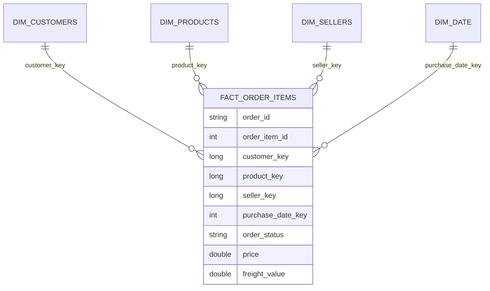

# Lakehouse Olist en streaming

Projet de portfolio en Data Engineering : architecture lakehouse (médaillon) construite autour du dataset public Olist (e-commerce brésilien), avec ingestion batch, contrôles qualité avec table de quarantaine, modèle en étoile Kimball, puis ingestion en streaming et orchestration (en cours).

**État au 21/10/2026** : la chaîne batch Bronze → Silver → Gold est terminée et validée. Le streaming Kafka, l'orchestration Airflow, la CI et le portage Databricks restent à faire (voir [Avancement](#avancement)).

## Architecture

Cible :

```
Producer Python (rejoue les commandes Olist)
  -> Kafka
  -> Spark Structured Streaming
  -> Delta Lake sur MinIO (S3)
       Bronze (brut)
       -> Silver (nettoyé + règles qualité) + Quarantaine
       -> Gold (modèle en étoile Kimball)
  -> orchestration Airflow, CI GitHub Actions, le tout en Docker Compose
```

Réalisé à ce jour (batch) :

```
CSV Olist (9 fichiers)
  -> Spark (batch)
  -> Bronze : 9 tables Delta, copie fidèle de chaque source
  -> Silver : lignes valides      + Quarantaine : lignes rejetées avec leur raison
  -> Gold   : 4 dimensions + 1 table de faits (modèle en étoile)
```

Portage prévu ensuite vers Databricks Free Edition (partie batch uniquement : le streaming Kafka reste en local, car Databricks Free Edition ne peut pas joindre un Kafka local). Options : remplacer MinIO par un bucket S3/GCS et tester la charge sur un jeu plus volumineux (NYC TLC).

## Stack technique

| Composant | Version |
|---|---|
| Apache Spark | 3.5.9 (Scala 2.12, Java 11) |
| Delta Lake | 3.3.3 (`delta-spark_2.12` + `delta-storage`) |
| Hadoop / hadoop-aws | 3.3.4 |
| aws-java-sdk-bundle | 1.12.262 |
| Stockage objet | fork `pgsty/silo:RELEASE.2026-09-16T00-00-00Z` (compatible S3/MinIO) |
| Great Expectations | série 0.18.x (`SparkDFDataset`) |
| boto3 | création des buckets (version non épinglée) |

Les versions sont épinglées volontairement (voir [Décisions](#décisions-et-compromis)).

## Structure du dépôt

```
.
├── docker-compose.yml          # services minio + spark
├── docker/spark/Dockerfile     # image Spark custom (dépendances Python)
├── docker/spark/jars/          # jars Spark (non versionnés, voir Setup)
├── requirements.txt            # dépendances Python installées dans l'image Spark
├── data/raw/                   # CSV Olist (non versionnés)
└── src/
    ├── common/spark_session.py # SparkSession partagée (config S3A + Delta)
    └── batch/
        ├── bronze_ingest.py        # CSV -> Bronze (9 tables Delta)
        ├── silver_quarantine.py    # Bronze -> Silver + Quarantaine
        ├── gold_star_schema.py     # Silver -> Gold (étoile Kimball)
        ├── validate_orders.py      # contrôles Great Expectations sur orders
        └── debug_reviews.py        # diagnostic de lecture CSV (order_reviews)
```

## Prérequis

- Docker + Docker Compose
- WSL2 si Windows, avec environ 10 Go de RAM alloués au minimum (14 Go utilisés pendant le développement, voir `.wslconfig`)
- Environ 300 Mo de disque pour les jars Spark/S3 (non versionnés)

## Setup

1. Cloner le dépôt :

   ```bash
   git clone https://github.com/Asmae27/olist-lakehouse.git
   cd olist-lakehouse
   ```

2. Télécharger les jars Spark (non versionnés, voir Décisions) :

   ```bash
   mkdir -p docker/spark/jars && cd docker/spark/jars
   wget https://repo1.maven.org/maven2/org/apache/hadoop/hadoop-aws/3.3.4/hadoop-aws-3.3.4.jar
   wget https://repo1.maven.org/maven2/com/amazonaws/aws-java-sdk-bundle/1.12.262/aws-java-sdk-bundle-1.12.262.jar
   wget https://repo1.maven.org/maven2/io/delta/delta-spark_2.12/3.3.3/delta-spark_2.12-3.3.3.jar
   wget https://repo1.maven.org/maven2/io/delta/delta-storage/3.3.3/delta-storage-3.3.3.jar
   cd ../../..
   ```

3. Télécharger le dataset « Brazilian E-Commerce Public Dataset by Olist » sur Kaggle et placer les 9 CSV dans `data/raw/`.

4. Construire l'image Spark et démarrer les services :

   ```bash
   docker compose build spark
   docker compose up -d
   docker compose ps
   ```

   `minio` doit être `healthy` et `spark` `running`.

5. Console MinIO : http://localhost:9001. Les identifiants de développement local sont ceux définis dans `docker-compose.yml` (voir [Limites connues](#limites-connues)).

## Exécuter le pipeline batch

Les scripts s'exécutent dans l'ordre depuis le conteneur Spark. Les buckets MinIO manquants sont créés automatiquement.

```bash
docker compose exec spark spark-submit /opt/spark/work-dir/src/batch/bronze_ingest.py
docker compose exec spark spark-submit /opt/spark/work-dir/src/batch/silver_quarantine.py
docker compose exec spark spark-submit /opt/spark/work-dir/src/batch/gold_star_schema.py
```

Chaque script affiche ses contrôles de cohérence (volumes, orphelins). Pour ne garder que les lignes utiles :

```bash
docker compose exec spark spark-submit /opt/spark/work-dir/src/batch/silver_quarantine.py 2>&1 | grep -E "lignes Bronze"
```

## Modèle de données

### Médaillon

| Couche | Contenu |
|---|---|
| Bronze | 9 tables Delta, une par CSV source, sans transformation métier |
| Silver | Lignes qui passent les règles qualité (6 tables) |
| Quarantaine | Lignes rejetées, avec une colonne `quarantine_reason` |
| Gold | Modèle en étoile pour l'analyse |

### Gold : étoile Kimball



- **Grain** : une ligne de `order_items` (un produit, dans une commande, vendu par un vendeur).
- **Mesures** : `price`, `freight_value`.
- **Dimensions dégénérées** : `order_id`, `order_item_id`, `order_status` restent dans la table de faits.
- **`dim_date`** : entièrement dérivée des données, bornes lues dans les dates d'achat réelles.
- **`dim_products`** : enrichie avec la traduction anglaise des catégories.

## Qualité des données

- **Règles uniques** : chaque règle est définie une seule fois (dictionnaire `DATA_QUALITY_RULES` dans `silver_quarantine.py`). La même définition sert à décider si une ligne est valide et à produire la raison de rejet.
- **Quarantaine** : une ligne qui viole une ou plusieurs règles va dans `quarantine/<table>/` avec la liste des règles violées dans `quarantine_reason`.
- **Réconciliation** : à chaque exécution, `lignes Silver + lignes quarantaine = lignes Bronze` est vérifié (aucune ligne perdue).
- **Validation de la détection** : un test volontaire (règle sur `review_comment_message`) a mis 58 247 lignes en quarantaine, ce qui confirme que le 0 observé avec les règles de base est un vrai négatif, pas un bug.
- **Great Expectations** : utilisé dans `validate_orders.py` (3 expectations sur `orders`). Les règles de Silver sont écrites en PySpark pur, volontairement, pour garder une seule source de vérité ligne par ligne.

### Note sur `order_reviews`

99 224 avis sont chargés en Bronze, contre 104 719 pour `wc -l` sur le CSV. Cet écart n'est pas une perte : certains commentaires clients contiennent des retours à la ligne et des guillemets doublés (`""`), conformes à la norme CSV, et `wc -l` compte alors plusieurs lignes physiques pour un seul enregistrement. Avec `multiLine=true` et `escape='"'`, Spark reconstitue correctement les enregistrements : 0 ligne corrompue détectée. Un garde-fou reste en place : toute ligne illisible serait conservée dans `quarantine/order_reviews_malformed_csv/` plutôt que perdue.

Les champs de commentaire vides (plus de la moitié des avis) sont une absence de saisie légitime, distincte des lignes mal formées.

## Décisions et compromis

**WSL2 plutôt que Windows natif.** Docker Desktop repose déjà sur WSL2. Développer directement dans WSL2 évite les fins de ligne CRLF (qui ont réellement cassé un `.gitignore`) et la lenteur d'I/O des montages `/mnt/c/...`. C'est aussi l'environnement le plus proche de la production et des runners Linux de la CI.

**Versions épinglées plutôt que `latest`.** Delta Lake ne fonctionne qu'avec une plage précise de versions de Spark, elle-même liée à une version de Scala. Un décalage ne se voit pas au démarrage mais à l'exécution (`NoSuchMethodError`, `ClassNotFoundException`). Épingler garantit aussi qu'un `docker compose up` relancé dans six mois produit le même environnement.

**Fork `pgsty/silo` plutôt que l'image MinIO officielle.** En septembre 2026, MinIO a retiré ses images `minio/minio` de Docker Hub, après être passé en mode maintenance. Deux options : figer une ancienne image officielle, qui ne recevrait plus de correctifs de sécurité, ou utiliser un fork maintenu compatible S3. J'ai retenu le fork. Compromis assumé : un projet plus jeune et moins éprouvé, en échange d'une maintenance de sécurité active.

**Jars non committés.** `aws-java-sdk-bundle` pèse environ 270 Mo, au-delà de la limite de 100 Mo par fichier de GitHub. Il est téléchargeable à l'identique depuis Maven Central. Un premier commit les avait inclus par erreur et le push avait été rejeté : l'historique a été réécrit et les jars sont désormais exclus via `.gitignore` et documentés dans le Setup.

**Image Spark personnalisée via Dockerfile.** Les jars se montent comme volumes, mais une dépendance Python (Great Expectations, boto3) doit être installée dans l'environnement du conteneur. Un `pip install` manuel disparaît à la recréation du conteneur : le `Dockerfile` rend l'installation reproductible.

**`PYTHONPATH` plutôt que `--py-files`.** Pour partager `src/common/` entre les scripts, `PYTHONPATH` suffit sur un conteneur unique. Sur un vrai cluster (Databricks), il faudra empaqueter le code (`--py-files` ou équivalent) : dette technique assumée pour le développement local.

**Grain `order_items` et `customer_id`.** Dans Olist, `customer_id` est unique par commande ; la personne réelle est `customer_unique_id`. La dimension reste au grain `customer_id` (jointure simple) et conserve `customer_unique_id` en attribut. Une analyse fine des clients récurrents demanderait une dimension au grain `customer_unique_id`.

**Clés de substitution par `row_number()`.** Déterministes, contrairement à `monotonically_increasing_id()` qui dépend du partitionnement. Valable parce que chaque dimension est dédoublonnée et réécrite en entier à chaque exécution. Pour de l'incrémental ou du streaming, il faudra une clé hachée stable (par exemple `xxhash64` de la clé naturelle).

**`overwrite` en Bronze.** Chaque exécution reconstruit la table à l'identique depuis le CSV (rechargement complet, idempotent). L'ingestion en streaming nécessitera `append` ou `MERGE`.

## Limites connues

- Identifiants MinIO en clair dans `docker-compose.yml` et dans les scripts : acceptable pour un environnement local de développement, à déplacer vers des variables d'environnement.
- Great Expectations n'est branché que sur `orders` ; les règles de Silver sont en PySpark.
- La fenêtre `row_number()` sans `partitionBy` ramène les données sur une partition : correct à ~100 000 lignes, pas à grande échelle.
- Aucun test automatisé ni CI pour l'instant.
- `boto3` n'est pas épinglé dans `requirements.txt`.

## Métriques

| Mesure | Valeur |
|---|---|
| Fichiers sources | 9 CSV |
| Lignes en Bronze | environ 1,55 million (dont 1 000 163 pour `geolocation`) |
| Tables Silver avec quarantaine | 6 |
| Dimensions Gold | 4 |
| Lignes de `fact_order_items` | 112 650 (égal à `silver/order_items`) |
| Clés orphelines (4 clés étrangères) | 0 |
| Expectations Great Expectations | 3 (sur `orders`) |
| Taux de quarantaine (règles de base) | 0 % |
| Services Docker Compose | 2 (`minio`, `spark`) |

À mesurer dans les prochaines phases : latence d'un micro-batch, temps de requête avant/après `OPTIMIZE`, volume traité en streaming.

## Avancement

- [x] Environnement Docker Compose (MinIO + Spark + Delta)
- [x] Connexion Spark ↔ MinIO validée
- [x] Bronze : 9 tables Delta
- [x] Silver + table de quarantaine, avec réconciliation des volumes
- [x] Couche Gold : modèle en étoile Kimball
- [ ] Producer Kafka + Spark Structured Streaming
- [ ] Orchestration Airflow
- [ ] CI GitHub Actions
- [ ] Portage Databricks Free Edition
