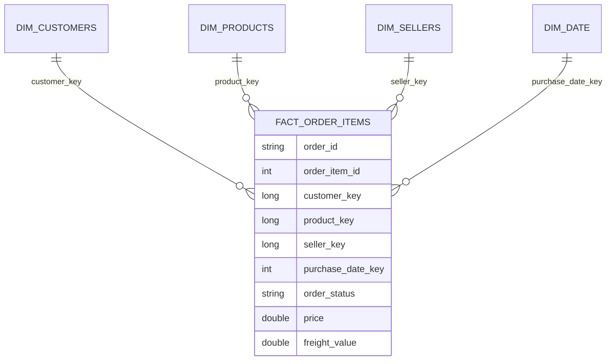

# Lakehouse Olist en streaming

Projet de portfolio en Data Engineering : architecture lakehouse (médaillon) construite autour du dataset public Olist (e-commerce brésilien), avec ingestion batch et streaming, contrôles qualité avec table de quarantaine, modèle en étoile Kimball et orchestration.

**État au 31/10/2026** : la chaîne batch Bronze → Silver → Gold est validée, ainsi que l'ingestion en streaming Kafka → Spark Structured Streaming → Bronze (Delta, avec checkpoint). Airflow est démarré et un premier DAG de démonstration a tourné ; l'orchestration du pipeline complet est en cours. La CI et le portage Databricks restent à faire (voir [Avancement](#avancement)).

## Architecture

Cible :

```
Producer Python (rejoue les commandes Olist)
  -> Kafka
  -> Spark Structured Streaming
  -> Delta Lake sur MinIO (S3)
       Bronze (brut)
       -> Silver (nettoyé + règles qualité) + Quarantaine
       -> Gold (modèle en étoile Kimball)
  -> orchestration Airflow, CI GitHub Actions, le tout en Docker Compose
```

Réalisé à ce jour :

```
Branche batch
  CSV Olist (9 fichiers) -> Spark -> Bronze (9 tables Delta)
                                  -> Silver + Quarantaine (lignes rejetées, avec raison)
                                  -> Gold (4 dimensions + 1 table de faits)

Branche streaming
  Producer (confluent-kafka, clé = order_id)
    -> Kafka (topic olist_orders, 3 partitions)
    -> Spark Structured Streaming (checkpoint dans MinIO)
    -> bronze/orders_stream (Delta, exactement une fois)
    -> upsert (MERGE sur order_id) dans silver/orders   [script écrit, validation en cours]
```

Portage prévu ensuite vers Databricks Free Edition (partie batch uniquement : le streaming Kafka reste en local, car Databricks Free Edition ne peut pas joindre un Kafka local). Options : remplacer MinIO par un bucket S3/GCS et tester la charge sur un jeu plus volumineux (NYC TLC).

## Stack technique

| Composant | Version |
|---|---|
| Apache Spark | 3.5.9 (Scala 2.12, Java 11) |
| Delta Lake | 3.3.3 (`delta-spark_2.12` + `delta-storage`) |
| Hadoop / hadoop-aws | 3.3.4 |
| aws-java-sdk-bundle | 1.12.262 |
| Connecteur Kafka de Spark | `spark-sql-kafka-0-10_2.12:3.5.9` (via `--packages`) |
| Stockage objet | fork `pgsty/silo:RELEASE.2026-09-16T00-00-00Z` (compatible S3/MinIO) |
| Kafka | `apache/kafka:4.4.0` (mode KRaft, un nœud) |
| Client Kafka Python | `confluent-kafka==2.16.0` |
| Airflow | 3.3.2, image personnalisée `olist-airflow:3.3.2` (ajoute le client Docker 28.5.1), `LocalExecutor`, PostgreSQL 16 |
| Great Expectations | série 0.18.x (`SparkDFDataset`) |
| boto3 | création des buckets (version non épinglée) |

Les versions sont épinglées volontairement (voir [Décisions](#décisions-et-compromis)).

## Structure du dépôt

```
.
├── docker-compose.yml          # services minio + spark + kafka
├── docker/spark/Dockerfile     # image Spark custom (dépendances Python)
├── docker/spark/jars/          # jars Spark (non versionnés, voir Setup)
├── requirements.txt            # dépendances Python installées dans l'image Spark
├── data/raw/                   # CSV Olist (non versionnés)
├── airflow/                    # projet Compose séparé : Airflow
│   ├── Dockerfile                  # image Airflow + client Docker
│   ├── docker-compose.yaml         # compose officiel 3.3.2, simplifié (LocalExecutor)
│   ├── docker-compose.override.yaml# socket Docker monté dans le scheduler seulement
│   └── dags/                       # DAGs (hello_pipeline ; pipeline complet en cours)
└── src/
    ├── common/
    │   ├── spark_session.py    # SparkSession partagée (config S3A + Delta)
    │   └── storage.py          # création des buckets MinIO manquants
    ├── producer/
    │   └── orders_producer.py  # rejoue les commandes vers Kafka (clé = order_id)
    ├── streaming/
    │   ├── kafka_to_console.py          # lecture Kafka -> console (validation du connecteur)
    │   ├── orders_stream_to_bronze.py   # Kafka -> bronze/orders_stream (Delta)
    │   └── silver_orders_from_stream.py # bronze/orders_stream -> silver/orders (MERGE)
    └── batch/
        ├── bronze_ingest.py        # CSV -> Bronze (9 tables Delta)
        ├── silver_quarantine.py    # Bronze -> Silver + Quarantaine
        ├── gold_star_schema.py     # Silver -> Gold (étoile Kimball)
        ├── validate_orders.py      # contrôles Great Expectations sur orders
        └── debug_reviews.py        # diagnostic de lecture CSV (order_reviews)
```

## Prérequis

- Docker + Docker Compose (v2.20 ou plus)
- WSL2 si Windows, avec 14 Go de RAM alloués pendant le développement (voir `.wslconfig`) : Spark, Kafka, MinIO et Airflow tournent ensemble
- Environ 300 Mo de disque pour les jars Spark/S3 (non versionnés), plus les images Docker

## Setup

1. Cloner le dépôt :

   ```bash
   git clone https://github.com/Asmae27/olist-lakehouse.git
   cd olist-lakehouse
   ```

2. Télécharger les jars Spark (non versionnés, voir Décisions) :

   ```bash
   mkdir -p docker/spark/jars && cd docker/spark/jars
   wget https://repo1.maven.org/maven2/org/apache/hadoop/hadoop-aws/3.3.4/hadoop-aws-3.3.4.jar
   wget https://repo1.maven.org/maven2/com/amazonaws/aws-java-sdk-bundle/1.12.262/aws-java-sdk-bundle-1.12.262.jar
   wget https://repo1.maven.org/maven2/io/delta/delta-spark_2.12/3.3.3/delta-spark_2.12-3.3.3.jar
   wget https://repo1.maven.org/maven2/io/delta/delta-storage/3.3.3/delta-storage-3.3.3.jar
   cd ../../..
   ```

3. Télécharger le dataset « Brazilian E-Commerce Public Dataset by Olist » sur Kaggle et placer les 9 CSV dans `data/raw/`.

4. Construire l'image Spark et démarrer les services :

   ```bash
   docker compose build spark
   docker compose up -d
   docker compose ps
   ```

   `minio` doit être `healthy`, `kafka` et `spark` `running`.

5. Créer le topic Kafka (une seule fois) :

   ```bash
   docker compose exec --workdir /opt/kafka/bin kafka \
     ./kafka-topics.sh --bootstrap-server kafka:19092 \
     --create --topic olist_orders --partitions 3 --replication-factor 1
   ```

6. Console MinIO : http://localhost:9001. Les identifiants de développement local sont ceux définis dans `docker-compose.yml` (voir [Limites connues](#limites-connues)).

### Airflow (projet Compose séparé)

```bash
cd airflow
docker build -t olist-airflow:3.3.2 .
mkdir -p dags logs plugins config
```

Créer `airflow/.env` (ignoré par Git) avec :

```
AIRFLOW_UID=<sortie de `id -u`>
AIRFLOW_IMAGE_NAME=olist-airflow:3.3.2
FERNET_KEY=<clé générée, voir ci-dessous>
DOCKER_GID=<groupe du socket Docker, voir ci-dessous>
```

- Générer la clé Fernet (elle chiffre les connexions et variables stockées en base) : `openssl rand -base64 32 | tr '+/' '-_'`. Ne pas la partager.
- Trouver le groupe du socket Docker (il dépend de l'installation de Docker Desktop) :
  `docker run --rm -v /var/run/docker.sock:/var/run/docker.sock alpine ls -ln /var/run/docker.sock` ; le groupe est le numéro de la deuxième colonne après `1`.

Puis :

```bash
docker compose up airflow-init     # migrations de la base, création de l'utilisateur
docker compose up -d
docker compose ps                  # tous les services en healthy
```

Interface : http://localhost:8080 (compte par défaut `airflow` / `airflow`, acceptable uniquement en local : ne jamais exposer ce port tel quel).

## Exécuter le pipeline

### Branche batch

Les scripts s'exécutent dans l'ordre depuis le conteneur Spark. Les buckets MinIO manquants sont créés automatiquement.

```bash
docker compose exec spark spark-submit /opt/spark/work-dir/src/batch/bronze_ingest.py
docker compose exec spark spark-submit /opt/spark/work-dir/src/batch/silver_quarantine.py
docker compose exec spark spark-submit /opt/spark/work-dir/src/batch/gold_star_schema.py
```

Chaque script affiche ses contrôles de cohérence (volumes, orphelins). `silver_quarantine.py` réécrit entièrement `silver/orders` : il doit donc passer **avant** l'upsert du flux (sinon les lignes issues du flux seraient écrasées).

### Branche streaming

1. Envoyer des commandes dans Kafka (rejeu chronologique ; `--skip` ignore les N premières, `--limit 0` envoie tout) :

   ```bash
   docker compose exec spark python3 /opt/spark/work-dir/src/producer/orders_producer.py --limit 100 --rate 50
   docker compose exec spark python3 /opt/spark/work-dir/src/producer/orders_producer.py --skip 100 --limit 100 --rate 50
   ```

2. Ingérer le topic dans `bronze/orders_stream` (lit uniquement les nouveaux messages grâce au checkpoint) :

   ```bash
   docker compose exec spark spark-submit \
     --packages org.apache.spark:spark-sql-kafka-0-10_2.12:3.5.9 \
     --conf spark.jars.ivy=/tmp/.ivy2 \
     /opt/spark/work-dir/src/streaming/orders_stream_to_bronze.py
   ```

3. Appliquer le flux à Silver (upsert sur `order_id`) :

   ```bash
   docker compose exec spark spark-submit /opt/spark/work-dir/src/streaming/silver_orders_from_stream.py
   ```

Pour repartir de zéro, supprimer **à la fois** `bronze/orders_stream/` et `checkpoints/orders_stream/` dans MinIO (un checkpoint sans sa table, ou l'inverse, est incohérent), et supprimer/recréer le topic si nécessaire.

## Modèle de données

### Médaillon

| Couche | Contenu |
|---|---|
| Bronze | 9 tables Delta (une par CSV source, sans transformation métier) + `orders_stream` (messages Kafka parsés, en texte, avec colonnes de traçabilité `kafka_*`) |
| Silver | Lignes qui passent les règles qualité (6 tables) |
| Quarantaine | Lignes rejetées, avec une colonne `quarantine_reason` |
| Gold | Modèle en étoile pour l'analyse |

### Gold : étoile Kimball



- **Grain** : une ligne de `order_items` (un produit, dans une commande, vendu par un vendeur).
- **Mesures** : `price`, `freight_value`.
- **Dimensions dégénérées** : `order_id`, `order_item_id`, `order_status` restent dans la table de faits.
- **`dim_date`** : entièrement dérivée des données, bornes lues dans les dates d'achat réelles.
- **`dim_products`** : enrichie avec la traduction anglaise des catégories.

## Qualité des données

- **Règles uniques** : chaque règle est définie une seule fois (dictionnaire `DATA_QUALITY_RULES` dans `silver_quarantine.py`). La même définition sert à décider si une ligne est valide et à produire la raison de rejet. Le job Silver du flux réutilise ces règles et y ajoute des règles propres au typage.
- **Quarantaine** : une ligne qui viole une ou plusieurs règles va dans `quarantine/<table>/` avec la liste des règles violées dans `quarantine_reason`.
- **Réconciliation** : à chaque exécution, `lignes Silver + lignes quarantaine = lignes Bronze` est vérifié (aucune ligne perdue).
- **Validation de la détection** : un test volontaire (règle sur `review_comment_message`) a mis 58 247 lignes en quarantaine, ce qui confirme que le 0 observé avec les règles de base est un vrai négatif, pas un bug.
- **Valeur absente ou mal formée** : dans le flux, les dates restent du texte en Bronze. En Silver, une chaîne vide devient `null` (absence légitime) ; une chaîne non vide illisible déclenche une règle `<colonne>_malformed` distincte, pour que la quarantaine distingue les deux causes.
- **Great Expectations** : utilisé dans `validate_orders.py` (3 expectations sur `orders`). Les règles de Silver sont écrites en PySpark pur, volontairement, pour garder une seule source de vérité ligne par ligne.

### Note sur `order_reviews`

99 224 avis sont chargés en Bronze, contre 104 719 pour `wc -l` sur le CSV. Cet écart n'est pas une perte : certains commentaires clients contiennent des retours à la ligne et des guillemets doublés (`""`), conformes à la norme CSV, et `wc -l` compte alors plusieurs lignes physiques pour un seul enregistrement. Avec `multiLine=true` et `escape='"'`, Spark reconstitue correctement les enregistrements : 0 ligne corrompue détectée. Un garde-fou reste en place : toute ligne illisible serait conservée dans `quarantine/order_reviews_malformed_csv/` plutôt que perdue.

Les champs de commentaire vides (plus de la moitié des avis) sont une absence de saisie légitime, distincte des lignes mal formées.

## Décisions et compromis

**WSL2 plutôt que Windows natif.** Docker Desktop repose déjà sur WSL2. Développer directement dans WSL2 évite les fins de ligne CRLF (qui ont réellement cassé un `.gitignore`) et la lenteur d'I/O des montages `/mnt/c/...`. C'est aussi l'environnement le plus proche de la production et des runners Linux de la CI.

**Versions épinglées plutôt que `latest`.** Delta Lake ne fonctionne qu'avec une plage précise de versions de Spark, elle-même liée à une version de Scala. Un décalage ne se voit pas au démarrage mais à l'exécution (`NoSuchMethodError`, `ClassNotFoundException`). Épingler garantit aussi qu'un `docker compose up` relancé dans six mois produit le même environnement.

**Fork `pgsty/silo` plutôt que l'image MinIO officielle.** En septembre 2026, MinIO a retiré ses images `minio/minio` de Docker Hub, après être passé en mode maintenance. Deux options : figer une ancienne image officielle, qui ne recevrait plus de correctifs de sécurité, ou utiliser un fork maintenu compatible S3. J'ai retenu le fork. Compromis assumé : un projet plus jeune et moins éprouvé, en échange d'une maintenance de sécurité active.

**Jars non committés.** `aws-java-sdk-bundle` pèse environ 270 Mo, au-delà de la limite de 100 Mo par fichier de GitHub. Il est téléchargeable à l'identique depuis Maven Central. Un premier commit les avait inclus par erreur et le push avait été rejeté : l'historique a été réécrit et les jars sont désormais exclus via `.gitignore` et documentés dans le Setup.

**Image Spark personnalisée via Dockerfile.** Les jars se montent comme volumes, mais une dépendance Python (Great Expectations, boto3, confluent-kafka) doit être installée dans l'environnement du conteneur. Un `pip install` manuel disparaît à la recréation du conteneur : le `Dockerfile` rend l'installation reproductible.

**`PYTHONPATH` plutôt que `--py-files`.** Pour partager `src/common/` entre les scripts, `PYTHONPATH` suffit sur un conteneur unique. Sur un vrai cluster (Databricks), il faudra empaqueter le code (`--py-files` ou équivalent) : dette technique assumée pour le développement local.

**Grain `order_items` et `customer_id`.** Dans Olist, `customer_id` est unique par commande ; la personne réelle est `customer_unique_id`. La dimension reste au grain `customer_id` (jointure simple) et conserve `customer_unique_id` en attribut. Une analyse fine des clients récurrents demanderait une dimension au grain `customer_unique_id`.

**Clés de substitution par `row_number()`.** Déterministes, contrairement à `monotonically_increasing_id()` qui dépend du partitionnement. Valable parce que chaque dimension est dédoublonnée et réécrite en entier à chaque exécution. Pour de l'incrémental ou du streaming, il faudra une clé hachée stable (par exemple `xxhash64` de la clé naturelle).

**`overwrite` en Bronze batch.** Chaque exécution reconstruit la table à l'identique depuis le CSV (rechargement complet, idempotent). Le flux, lui, écrit en `append` avec un checkpoint.

**Image Kafka officielle `apache/kafka`, mode KRaft.** Pas de ZooKeeper : un seul conteneur joue les rôles de broker et de contrôleur. Deux listeners : `INTERNAL` (`kafka:19092`) pour les conteneurs, `EXTERNAL` (`localhost:9092`) pour la machine hôte. Un client Kafka se reconnecte à l'adresse que le broker lui **annonce** : annoncer `localhost` à un autre conteneur le ferait pointer sur lui-même.

**Clé = `order_id`, 3 partitions.** Kafka ne garantit l'ordre qu'à l'intérieur d'une partition : la clé envoie toutes les occurrences d'une même commande dans la même partition. Vérifié : les 100 mêmes commandes se répartissent à l'identique (28 / 39 / 33) sur deux exécutions indépendantes.

**`confluent-kafka` plutôt que `kafka-python`.** Les deux sont maintenues. `confluent-kafka` s'appuie sur `librdkafka` (client C de référence, plus rapide) et est celle qu'on rencontre le plus en entreprise ; contrepartie : une dépendance native, alors que `kafka-python` est du Python pur.

**Table Bronze du flux séparée (`orders_stream`).** `bronze/orders` est réécrite en `overwrite` par le job batch et son schéma est typé, alors que le flux est en texte brut. Contrepartie : Silver doit consommer les deux.

**Checkpoint dans MinIO et exactement une fois.** Le checkpoint mémorise les offsets Kafka traités ; le sink Delta enregistre dans son journal l'identifiant de la requête et le numéro de micro-batch, ce qui rend l'écriture idempotente si un batch est rejoué après une panne. Vérifié : 100 → 100 (aucun nouveau message, aucun nouveau commit) → 200 lignes, 0 doublon. `trigger(availableNow=True)` vide le topic puis s'arrête : adapté à un déclenchement par un orchestrateur.

**Connecteur Kafka via `--packages`.** C'est la méthode documentée par Spark, qui résout automatiquement les dépendances. Contrepartie : un accès à Maven Central à l'exécution, donc une reproductibilité moindre que les jars montés. À réévaluer plus tard.

**`MERGE` plutôt que `overwrite` pour appliquer le flux à Silver.** Un `overwrite` remplacerait l'historique par les seules lignes du flux. Le `MERGE` sur `order_id` met à jour les commandes existantes et insère les nouvelles, de façon transactionnelle. La source doit être dédupliquée au préalable (un `MERGE` échoue si plusieurs lignes sources visent la même ligne cible).

**Airflow en `LocalExecutor`, dans un projet Compose séparé.** Sur une seule machine, le CeleryExecutor demanderait Redis et des workers sans bénéfice. Airflow ne calcule rien ici : il déclenche des jobs dont le calcul se fait dans Spark. Le compose officiel reste proche de l'original ; les choix propres au projet sont isolés dans un fichier de surcharge.

**Lancer Spark depuis Airflow par `docker exec` et le socket Docker.** Un seul environnement Spark à maintenir (jars, versions) plutôt qu'un second dans l'image d'Airflow. Contrepartie de sécurité assumée : le socket Docker donne à qui y accède un contrôle équivalent à `root` sur le moteur. Acceptable sur une machine de développement ; en production, on passerait par un proxy de socket restreint, un `DockerOperator` ou Kubernetes. Le socket n'est monté que dans le scheduler (pas dans le composant exposé sur le port 8080), et l'accès passe par un groupe dédié (`DOCKER_GID`) plutôt que par `root`.

## Limites connues

- Identifiants MinIO en clair dans `docker-compose.yml` et dans les scripts, et compte Airflow par défaut : acceptable pour un environnement local, à déplacer vers des variables d'environnement.
- Le topic Kafka se crée à la main (étape 5 du Setup) ; Airflow n'orchestre pas encore le pipeline complet.
- `silver_quarantine.py` réécrit `silver/orders` en entier : l'ordre d'exécution compte (batch, puis flux). Une évolution serait de faire du batch aussi un `MERGE`.
- Rejouer le producer sans `--skip` renvoie les mêmes commandes : le checkpoint évite de relire un même message, pas de dédupliquer des messages distincts portant le même `order_id` (c'est le rôle de la déduplication en Silver).
- Delta Lake sur S3 n'est sûr que s'il n'y a qu'un seul écrivain à la fois par table : ne pas lancer deux exécutions simultanées du même job.
- Great Expectations n'est branché que sur `orders` ; les règles de Silver sont en PySpark.
- La fenêtre `row_number()` sans `partitionBy` ramène les données sur une partition : correct à ~100 000 lignes, pas à grande échelle.
- Aucun test automatisé ni CI pour l'instant.
- `boto3` n'est pas épinglé dans `requirements.txt`.

## Métriques

| Mesure | Valeur |
|---|---|
| Fichiers sources | 9 CSV |
| Lignes en Bronze (batch) | environ 1,55 million (dont 1 000 163 pour `geolocation`) |
| Tables Silver avec quarantaine | 6 |
| Dimensions Gold | 4 |
| Lignes de `fact_order_items` | 112 650 (égal à `silver/order_items`) |
| Clés orphelines (4 clés étrangères) | 0 |
| Expectations Great Expectations | 3 (sur `orders`) |
| Taux de quarantaine (règles de base) | 0 % |
| Topic Kafka | 3 partitions, 1 réplique |
| Streaming : lignes ingérées en Bronze | 200 commandes en deux exécutions incrémentales (100 + 100), 0 doublon |
| Streaming : durée d'un micro-batch (100 messages) | environ 1,3 s (premier batch, à froid : non représentatif d'une latence en régime établi) |
| Services Docker Compose | 3 (`minio`, `spark`, `kafka`) + 5 pour Airflow (projet séparé) |

À mesurer dans les prochaines phases : latence en régime établi, temps de requête avant/après `OPTIMIZE`, durée du DAG complet.

## Avancement

- [x] Environnement Docker Compose (MinIO + Spark + Delta)
- [x] Connexion Spark ↔ MinIO validée
- [x] Bronze : 9 tables Delta
- [x] Silver + table de quarantaine, avec réconciliation des volumes
- [x] Couche Gold : modèle en étoile Kimball
- [x] Kafka (KRaft) + producer Python (clé = `order_id`)
- [x] Spark Structured Streaming : Kafka → `bronze/orders_stream` (checkpoint, exactement une fois)
- [ ] Silver alimenté depuis le flux par `MERGE` (script écrit, validation en cours)
- [x] Airflow démarré (`LocalExecutor`) et DAG de démonstration exécuté
- [ ] DAG du pipeline complet (lancement des jobs Spark depuis Airflow, tentatives, contrôles qualité bloquants)
- [ ] CI GitHub Actions
- [ ] Portage Databricks Free Edition